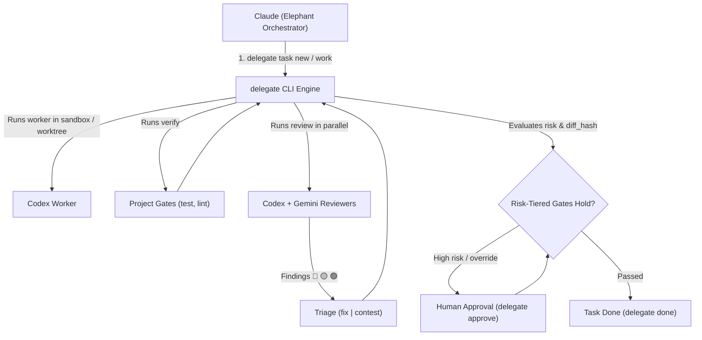

# delegate: a multi-agent orchestration and enforcement engine

[](https://github.com/taherfarg/claude-delegate-skill/actions/workflows/ci.yml)
[](LICENSE)
[](https://python.org)

Claude Code acts as the **elephant**: it holds context, plans work, writes briefs, and makes final architectural calls. It delegates heavy lifting to the AI subscriptions you already pay for:

- **ChatGPT, via the [Codex CLI](https://github.com/openai/codex):** writes features, tests, and fixes in a sandbox.
- **Gemini, via the Antigravity CLI (`agy`):** codebase research and independent reviews.

Both serve as **goldfish reviewers**: fresh-context second opinions that never see conversation history, catching blind spots the elephant cannot see.

In v1, delegation was guided by prompt instructions alone; real-world runs showed that mechanical steps (diff scoping, timeouts, process cleanup, gate enforcement) can be skipped or mishandled. **delegate v2** introduces a standard-library Python CLI engine (`delegate`) that Claude calls. The engine enforces timeouts, kills hanging process trees, scans for secrets, freezes diffs, and refuses `done` unless evidence-based gates pass on the current code.

> [!NOTE]
> **Built by v1:** v2 was built dogfooding v1. Codex implemented Tasks 1–3 and 5; Gemini implemented Tasks 4 and 6–10 after Codex reached its usage limit; Claude orchestrated, reviewed, merged, and fixed integration details.

---

## Architecture Flow



---

## Risk-Tiered Gates

Task status and completion are derived from evidence on the current diff hash (`diff_hash`). Changing code invalidates stale checks automatically.

| Risk Level | Trigger Condition | Requirements on Current `diff_hash` to Pass `done` |
|---|---|---|
| **Low** | Every changed file matches `risk.low` (defaults: `*.md`, `*.txt`, `*.css`, images, `docs/**`) | All configured project gates pass (`PASS`). |
| **Medium** | Default tier when neither low nor high. | All gates pass + clean review round (if Codex wrote code, Gemini required; otherwise either reviewer) + all 🔴/🟡 triaged. |
| **High** | Any changed file matches `risk.high` (defaults: auth, migrations, SQL, billing, CI, manifests, configs, `delegate.toml`) | All gates pass + **both** Codex and Gemini ran clean + all 🔴/🟡 triaged + human approval via `delegate approve`. |

---

## Command Reference

| Command | Description |
|---|---|
| `delegate doctor` | Pre-flight checks: verifies `codex login status`, `agy models`, git, and Python version. |
| `delegate init` | Detects project stack and generates `delegate.toml`; excludes `.delegate/` from git. |
| `delegate task new <id> --title <T> --files <G...> [--worktree]` | Creates task baseline, dirty-file snapshot, and file scope. Optional git worktree. |
| `delegate scope <id> add <globs...>` | Expands allowed file scope for a task. |
| `delegate work <id> --brief <file>` | Runs worker in sandbox with process-tree timeout; prints capped summary & diff stat. |
| `delegate verify <id>` | Runs configured project gates sequentially in the task tree. |
| `delegate review <id> --goal <G> [--criteria-file <F>]` | Scans secrets, freezes diff, and runs Codex + Gemini in parallel goldfish review. |
| `delegate triage <id> <finding_id> {fix,contest} [<reason>] [--same-as <old>]` | Records `fix` or `contest` for a finding. Each round's findings get new ids; link a repeat with `--same-as`. |
| `delegate status [<id>]` | Shows derived task phase, risk, changed files, blockers, and next command. |
| `delegate approve <id>` | Human-only interactive approval for high-risk changes or reviewer overrides. |
| `delegate done <id>` | Enforces completion gates, records metrics, and prints worktree merge steps. |
| `delegate abandon <id>` | Marks task abandoned and records metrics. |
| `delegate report` | Displays aggregated performance metrics from `~/.delegate/metrics.jsonl`. |

---

## Installation

### 1. Install Skill for Claude Code
Clone the repository into your Claude Code skills directory:

**macOS / Linux / Git Bash:**
```bash
git clone https://github.com/taherfarg/claude-delegate-skill ~/.claude/skills/delegate
```

**PowerShell:**
```powershell
git clone https://github.com/taherfarg/claude-delegate-skill "$env:USERPROFILE\.claude\skills\delegate"
```

### 2. Install the `delegate` CLI
Requires Python >= 3.11 (standard library only at runtime). Install it from the skill folder you just cloned, so a single `git pull` there updates both the skill and the engine:

```bash
pip install --user -e ~/.claude/skills/delegate
```

PowerShell: `pip install --user -e "$env:USERPROFILE\.claude\skills\delegate"`. If `delegate` isn't found afterwards, add Python's user scripts folder to PATH (`python -m site --user-base`, then its `Scripts`/`bin`), or run `python -m delegate`.

Verify your environment:
```bash
delegate doctor
```

---

## Configuration (`delegate.toml`)

Create a `delegate.toml` in your repository root, or run `delegate init`:

```toml
# delegate.toml

# Project identifier (defaults to directory name)
project = "my-project"

# Model for Gemini reviews via agy (top-level key)
gemini_model = "gemini-3.8-flash-high"

# Allow completion if no gates are defined (default: false)
allow_no_gates = false

[gates]
lint = "npm run lint"
typecheck = "npm run typecheck"
test = "pytest -q"

[risk]
# Additional globs extending default risk classifications
low = ["static/**"]
high = ["src/billing/**", "src/auth/**"]

[secrets]
# Globs permitted to contain credential-like patterns (e.g. test fixtures)
allow = ["tests/fixtures/**"]

[worktree]
# Setup command run once upon worktree creation
setup = "npm ci"

[timeouts]
worker = 900          # Codex worker timeout (seconds)
codex_review = 300    # Codex review timeout (seconds)
agy_review = 480      # Gemini review timeout (seconds)
gate = 600            # Gate timeout (seconds)
```

---

## Metrics

`delegate report` summarizes every finished task across your projects (counts only, no code or finding text). The first real end-to-end run, on 2026-11-27, was a small `slugify` task. Codex was out of quota that day, so it shows the "unavailable" path too:

```
tasks by outcome: done: 1
mean rounds: 4.0
findings per reviewer by severity:
  codex: blocker: 0, major: 0, nit: 0 (total: 0)
  gemini: blocker: 0, major: 1, nit: 1 (total: 2)
not_run/unavailable per reviewer:
  codex: not_run: 0, unavailable: 4 (ran: 0)
  gemini: not_run: 2, unavailable: 0 (ran: 2)
```

Gemini's 🟡 was real: `slugify("café")` gave `caf`. It was fixed test-first. The fix made the earlier review stale, and a fresh round came back clean before `done` passed. The two `not_run` rounds came from real `agy` integration problems: git-excluded paths, relative paths and agy's own skills folder. Fixing them made Gemini review successfully, and those failed rounds don't count toward the 3-round cap.

### How v2 itself was built

| | |
|---|---|
| Codex (ChatGPT) | Tasks 1–3, 5, then hit its usage limit |
| Gemini (`agy --mode accept-edits`) | Tasks 4, 6–10 and the first review-fix pass |
| Claude | briefs, test runs, merges, an independent review of Gemini's code (5 real issues fixed test-first), real-CLI debugging |
| Result | 129 tests, CI green on Windows, Linux and macOS × Python 3.11–3.13 |

---

## Credits

Inspired by the Elephant + Goldfish Model ([google/elephant-goldfish-model](https://github.com/google/elephant-goldfish-model)).

## License

[MIT](LICENSE)
