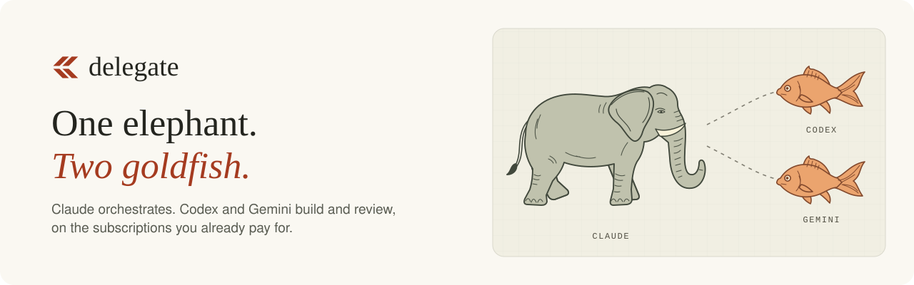
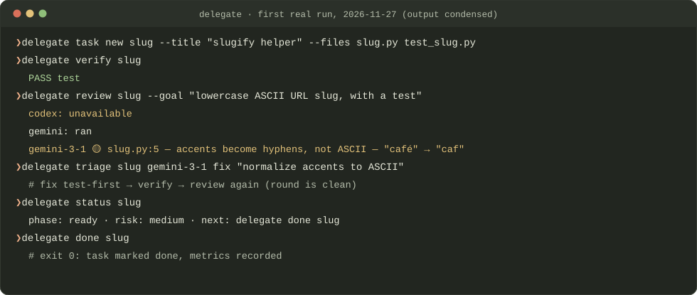
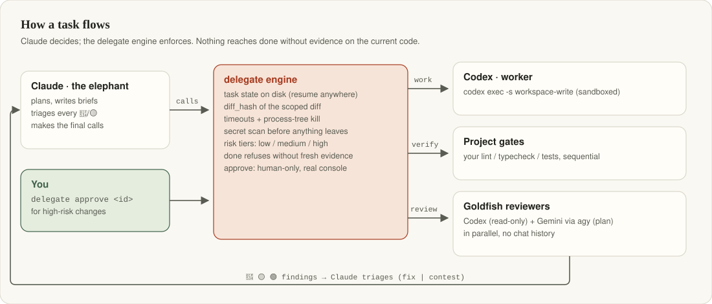
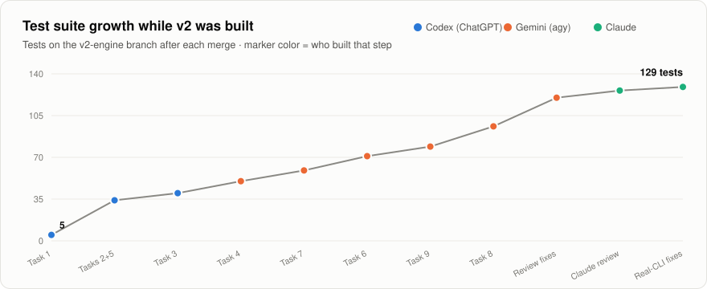
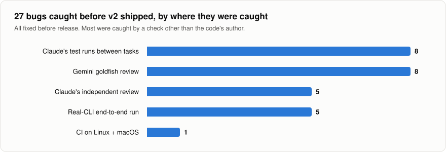
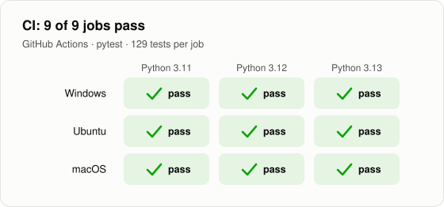
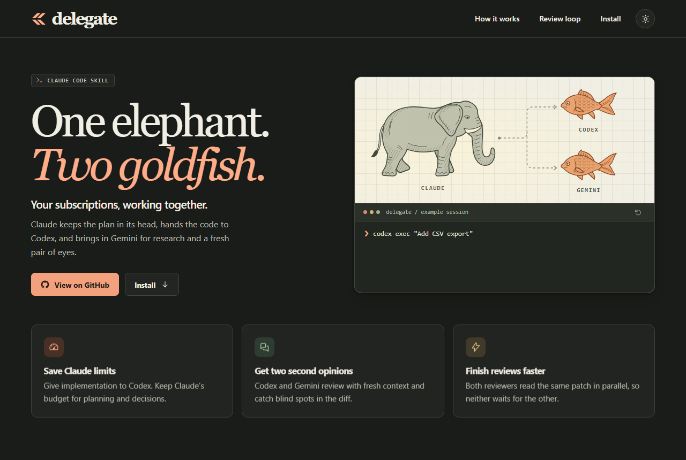

<p align="center">
  <picture>
    <source media="(prefers-color-scheme: dark)" srcset="assets/banner-dark.svg">
    
  </picture>
</p>

<p align="center">
  <a href="https://github.com/taherfarg/claude-delegate-skill/actions/workflows/ci.yml"></a>
  <a href="https://github.com/taherfarg/claude-delegate-skill/releases/latest"></a>
  
  
  
  <a href="LICENSE"></a>
</p>

<p align="center">
  <a href="https://taherfarg.github.io/claude-delegate-skill/"><b>Website</b></a> ·
  <a href="#quickstart">Quickstart</a> ·
  <a href="#how-it-works">How it works</a> ·
  <a href="#proof-it-works">Proof it works</a> ·
  <a href="CHANGELOG.md">Changelog</a>
</p>

**delegate** turns Claude Code into the lead of a three-model team, using the subscriptions you already pay for and no API keys.
- **Claude (the elephant)** keeps the context, plans, writes briefs and makes the final calls.
- **ChatGPT, through the [Codex CLI](https://github.com/openai/codex),** writes code in a sandbox.
- **Gemini, through the Antigravity CLI (`agy`),** researches and reviews.

Codex and Gemini also act as **goldfish reviewers**: fresh-context second opinions that never see the chat, so they catch what the elephant stopped seeing.

What makes it more than a prompt is the **`delegate` engine**: a small Python CLI, standard library only, that Claude calls. It runs the workers and reviewers with timeouts and scans for secrets. It also **refuses to mark a task done** until every required check has passed *on the current code*.

<p align="center">
  
</p>

## Why

| You want | delegate gives you |
|---|---|
| **To save Claude usage** | Codex does the heavy coding and Claude only reads briefs, diffs and findings. |
| **A real second opinion** | Two *different* models review every change with no chat history, in parallel. |
| **Speed** | Independent tasks run at the same time, each in its own git worktree. |
| **To trust "done"** | Evidence is tied to a hash of the current diff. Edit one line and every check is stale again. |

## How it works

<p align="center">
  <picture>
    <source media="(prefers-color-scheme: dark)" srcset="assets/architecture-dark.svg">
    
  </picture>
</p>

```
delegate task new → work → verify → review → triage → (fix → verify → review) → done
```

The engine decides what `done` requires from the files a task touched:

| Risk | When | `done` requires, on the current `diff_hash` |
|---|---|---|
| 🟢 **Low** | only docs, text, CSS or images changed | every project gate passes |
| 🟡 **Medium** | everything else | gates pass + a clean review from the model that **didn't** write the code + every 🔴/🟡 contested |
| 🔴 **High** | auth, migrations, SQL, billing, CI, dependency manifests, test/lint config, `delegate.toml` | gates pass + **both** reviewers clean + **your** `delegate approve` in a real terminal |

A check that is missing, stale, failed or timed out **never** counts as passed. Claude can't approve on your behalf: `approve` requires an interactive console and refuses piped input and the Windows `NUL` device.

## Quickstart

**1. Requirements:**
- [Claude Code](https://claude.com/claude-code)
- the [Codex CLI](https://github.com/openai/codex), logged in with ChatGPT (`codex login`)
- the Antigravity CLI (`agy`), logged in with Google
- git
- Python 3.11+

**2. Install.** Clone the skill, then install the engine from that same folder, so one `git pull` updates both:

```bash
git clone https://github.com/taherfarg/claude-delegate-skill ~/.claude/skills/delegate
pip install --user -e ~/.claude/skills/delegate
delegate doctor
```

<details><summary>PowerShell</summary>

```powershell
git clone https://github.com/taherfarg/claude-delegate-skill "$env:USERPROFILE\.claude\skills\delegate"
pip install --user -e "$env:USERPROFILE\.claude\skills\delegate"
python -m delegate doctor
```
If `delegate` isn't on PATH, add Python's user `Scripts` folder to it, or use `python -m delegate`.
</details>

**3. Use it.** Open a project in Claude Code and ask as usual ("build the CSV export"), or be explicit ("use codex for this", "get a second opinion"). Claude drives the commands; you only step in for `delegate approve`.

<details><summary>Command reference</summary>

| Command | What it does |
|---|---|
| `delegate doctor` | checks the Codex login, the `agy` model, git and Python |
| `delegate init` | writes `delegate.toml` with gates detected from your stack |
| `delegate task new <id> --title T --files G… [--worktree]` | records the baseline, your uncommitted edits, and the task's scope |
| `delegate scope <id> add G…` | widens the scope |
| `delegate work <id> --brief FILE` | runs the Codex worker (sandboxed, timed) |
| `delegate verify <id>` | runs your gates one by one, without stopping at the first failure |
| `delegate review <id> --goal G` | scans for secrets, freezes the diff, runs Codex + Gemini in parallel |
| `delegate triage <id> <finding> fix\|contest "why"` | records a decision; `--same-as` links a repeated finding |
| `delegate status [<id>]` | phase, risk, blockers and the exact next command (this is how you resume) |
| `delegate approve <id>` | **human only**, in a real terminal |
| `delegate done <id>` / `abandon <id>` | finishes the task and records metrics |
| `delegate report` | metrics across all your projects (counts only, never code) |
</details>

<details><summary><code>delegate.toml</code> example</summary>

```toml
gemini_model = "gemini-3.8-flash-high"

[gates]
lint = "npm run lint"
typecheck = "npm run typecheck"
test = "npm test"

[risk]                 # extends the defaults; defaults can't be removed
high = ["src/billing/**"]

[secrets]
allow = ["tests/fixtures/**"]

[worktree]
setup = "npm ci"

[timeouts]             # seconds
worker = 900
codex_review = 300
agy_review = 480
gate = 600
```
</details>

## Proof it works

v2 was **built by v1**:
- **Codex** wrote Tasks 1–3 and 5, until ChatGPT's usage limit hit mid-build.
- **Gemini** (`agy --mode accept-edits`) took over Tasks 4 and 6–10.
- **Claude** wrote the briefs, ran every test, merged, and did an independent review of Gemini's code.

<picture>
  <source media="(prefers-color-scheme: dark)" srcset="assets/chart-tests-dark.svg">
  
</picture>

<picture>
  <source media="(prefers-color-scheme: dark)" srcset="assets/chart-bugs-dark.svg">
  
</picture>

Each layer caught bugs the one before it missed. The real-CLI run alone found 5 problems that 120+ unit tests with fake CLIs couldn't:
- `agy` can't read git-excluded paths
- it resolves relative paths against the wrong folder
- it auto-loads its own skills
- Windows pipes are cp1252, which crashed on the finding icons
- Windows reports `NUL` as a terminal

<p align="center">
  <picture>
    <source media="(prefers-color-scheme: dark)" srcset="assets/ci-matrix-dark.svg">
    
  </picture>
</p>

`delegate report` after the first real task (Codex was out of quota that day, so this also shows the `unavailable` path):

```
tasks by outcome: done: 1
findings per reviewer by severity:
  gemini: blocker: 0, major: 1, nit: 1 (total: 2)
not_run/unavailable per reviewer:
  codex: not_run: 0, unavailable: 4 (ran: 0)
  gemini: not_run: 2, unavailable: 0 (ran: 2)
```

The charts come from real numbers in [`scripts/make_visuals.py`](scripts/make_visuals.py) (`python scripts/make_visuals.py` rebuilds them).

## Project site

<a href="https://taherfarg.github.io/claude-delegate-skill/"></a>

## Docs

- [`SKILL.md`](SKILL.md): what Claude follows (sequence, rules, safety)
- [`docs/manual.md`](docs/manual.md): manual recipes when the engine isn't installed
- [Design spec](docs/superpowers/specs/2026-11-27-delegate-v2-design.md) and [implementation plan](docs/superpowers/plans/2026-11-27-delegate-v2-engine.md)
- [CONTRIBUTING](CONTRIBUTING.md) · [SECURITY](SECURITY.md) · [CHANGELOG](CHANGELOG.md)

## Credits

The elephant + goldfish idea comes from [google/elephant-goldfish-model](https://github.com/google/elephant-goldfish-model).

## License

[MIT](LICENSE)
